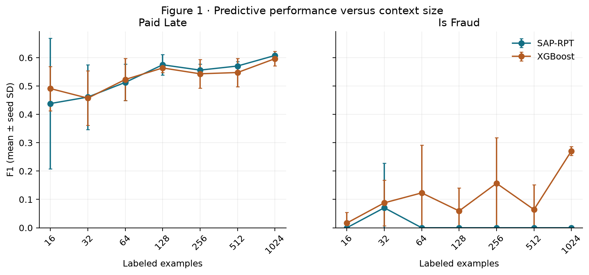
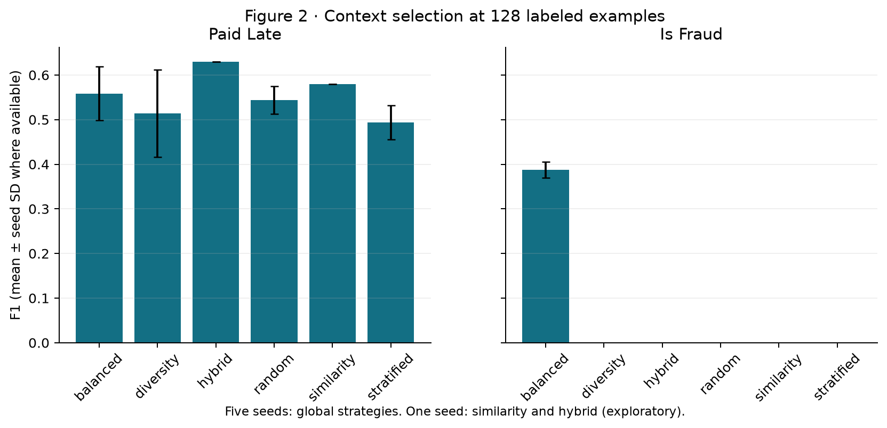
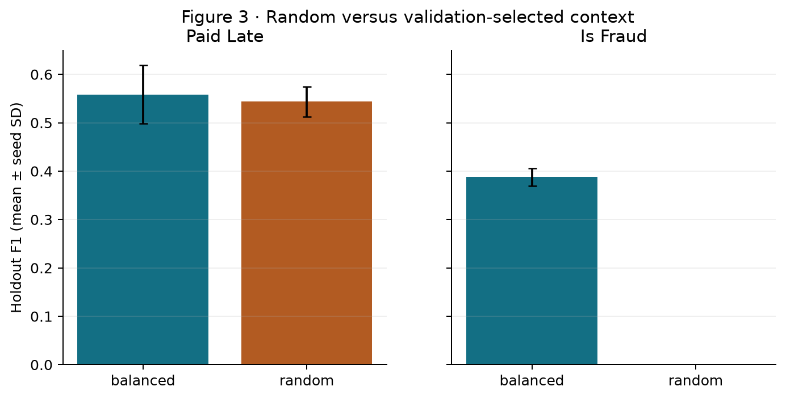
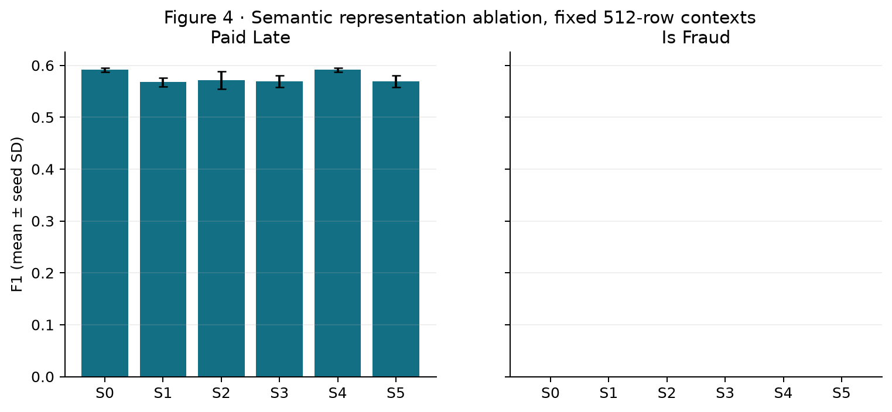
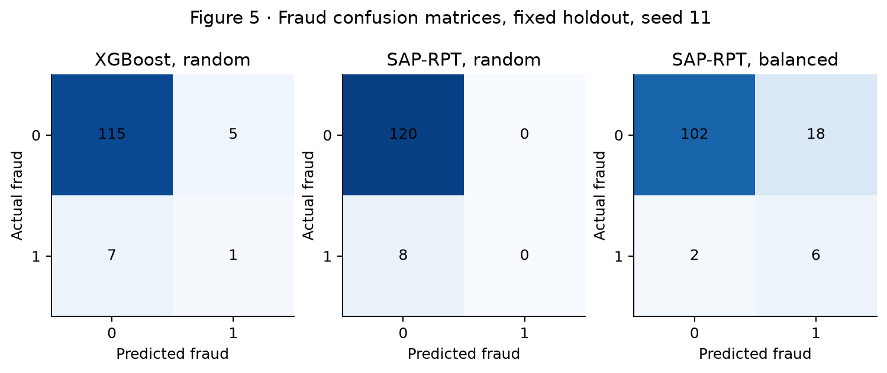
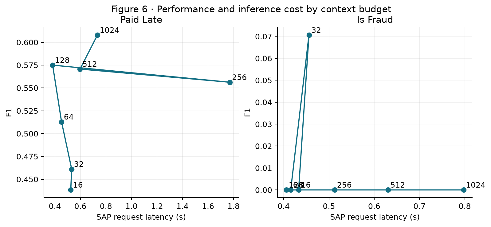

# SAP RPT Context Engineering Benchmark

## Research motivation and dataset

Can SAP RPT-1.6 improve without changing model weights by choosing better labeled context? This benchmark uses the frozen 1,152-row synthetic invoice snapshot in `data/semantic_ablation/source_snapshot.csv` (1,024 eligible context records, 128 final holdout). The current working CSV contains user-modified fraud labels; older published scores refer to another label version and are excluded here. The final holdout has 8 fraud positives.

## Hypotheses and protocol

We tested context budgets 16–1,024, random/stratified/balanced/diverse selection, query-specific similarity and hybrid selection where saved, context label noise, and a paired semantic ablation. Five seeds define the main context comparisons. The first 896 context rows are eligible for validation selection, the next 128 form validation, and the final 128 remain the fixed holdout. For the 1,024-row budget, all eligible context rows are used; its SAP repeats have identical input and are not independent. All SAP requests use the configured deployment; the protocol JSON records its configured model label and source checksum. RPT returns class labels, so ROC-AUC and PR-AUC are unavailable.

## Context selection strategies and implementation

`src/context_engineering/selection.py` implements random, stratified, class-balanced, mixed-type nearest-neighbor similarity, greedy farthest-point diversity, and a hybrid of nearest, minority and diverse rows. Numeric scaling and categorical encoding fit only on eligible context rows. Query-specific strategies never inspect query labels. The runner saves row-level predictions, metrics and per-query checkpoints. A serial request rate limits SAP calls. Similarity and hybrid each completed all 128 holdout invoices with seed 11. They were not evaluated on validation and therefore cannot be declared the selected winner.

## Actual findings

At 128 labeled examples, random-context SAP RPT had mean late-payment F1 0.544 and fraud F1 0.000. Validation chose **balanced** for late payment and **balanced** for fraud by mean F1. Their final-holdout F1 values were 0.558 and 0.388. For fraud, the selected strategy reached recall 0.750 with 17.0 false positives on average per 128 invoices. This is a sensitivity/precision tradeoff, not unqualified superiority.

At this budget, balanced fraud context included all 53 available positive examples plus 75 negatives; random context contained 3–8 positives across seeds. The higher recall therefore reflects much greater minority-label exposure and a changed effective class prior at the same total budget.

Paired selected-minus-random F1 across the same five seeds was +0.015 (SD 0.041) for late payment and +0.388 (SD 0.018) for fraud. These seed-level differences are descriptive because both the validation and holdout contain few fraud positives. Per-seed predictions are retained in the CSV files.

Exploratory one-seed query-specific results: similarity late-payment F1 0.579, hybrid late-payment F1 0.630; both had fraud F1 0.000. Hybrid's late-payment result came with 36 false positives. These methods require 128 SAP requests per target and were not validation-selected.

XGBoost class-1 probabilities support ROC-AUC and average precision; at the 128-row budget, its mean fraud ROC-AUC was 0.624 and mean average precision 0.132. SAP RPT returned only a top class in these requests, so no directly comparable probability metric was calculated.

At 20% context-label noise, late-payment F1 was 0.301 versus 0.544 at 0%. Replacing 20% of examples with duplicates gave late-payment F1 0.540; the DACH-only regional shift gave 0.534. Fraud F1 stayed at zero for these random-context robustness controls, so they do not establish fraud robustness.

The noise intervention flips a fixed fraction of context labels in both directions. Because fraud is rare, this also changes the observed context class prior; a pure label-corruption effect cannot be isolated from that prior shift here.

The fixed 512-row semantic ablation found S3−S0 paired late-payment F1 -0.022 (seed SD 0.007) and fraud F1 +0.000. S4 is identical to S0 because the source has no missing values, duplicate IDs or invalid numeric/category values; S5 is identical to S3. Thus cleaning has no measured effect in this dataset. Semantic effects cannot be generalized from three context samples and eight fraud positives. The semantic experiment changed names and categorical strings only; XGBoost used an invariant encoded matrix.

On the internal validation slice, S3 had the highest mean late-payment F1 (0.490 versus S0 0.477); all four semantic conditions tied for fraud, so S0 was retained. On the untouched final holdout, validation-selected S3 had mean late-payment F1 0.570 versus S0 0.592. This reversal is evidence that the apparent validation gain did not transfer in this small study.

A separate matched single-target feature-selection test removed `weekend_submission` from late-payment requests and `region` from fraud requests because those fields are absent from the corresponding generator formulas. Late-payment F1 was 0.576 versus 0.575; fraud F1 stayed at zero. Feature removal was not part of S0–S5 and does not explain their semantic differences.

The S3−S0 cleaning interaction is exactly zero because S4/S5 are identity controls. Context-sample stability should be read from the per-seed SD, not from repeated calls with identical 1,024-row input. The exact two-sided paired sign-flip p value for the three late-payment semantic differences is 0.25; this does not support a significance claim.

## Does Semantic Context Improve SAP-RPT Predictions?

On this synthetic dataset, more descriptive names and labels did not improve the measured late-payment result: S3−S0 F1 was -0.022 across three paired contexts. Fraud F1 stayed at zero for S0–S5, so the study cannot show a fraud benefit. Classical XGBoost predictions are identical across semantic conditions by construction. Cleaning made no change to the already complete values. Context selection had a larger measured effect, especially for fraud, while raising false alarms. **TechEd conclusion:** choose and validate labeled context before claiming a semantic gain; this experiment provides no evidence that renaming features improves SAP RPT on these invoices.

## Limitations and follow-up

The labels and features are synthetic; there are only eight holdout fraud cases. The original feature names were already descriptive and there are no free-text fields. The model label comes from configuration and should be checked against SAP deployment metadata before public version claims. Similarity and hybrid each have only one seed because per-query requests encounter API rate limits. Query-specific elapsed times include serial request pacing and any retry delays, so they are end-to-end costs rather than pure model latency. A larger external dataset, more seeds, class-score API support and calibration would strengthen the conclusions. Holdout comparisons of multiple strategies are descriptive; only the validation-selected strategy is eligible for a preselected final claim.

## Reproducibility

Install `requirements-experiment.txt`, then run `python -m pytest -q tests/test_context_selection.py` and `python scripts/validate_context_benchmark.py`. The runners default to dry run: `python scripts/run_context_benchmark.py size` and `python scripts/run_semantic_ablation.py`. Add `--live` only with configured SAP credentials. Then run `python scripts/build_context_report.py`. All published tables live under `data/context_benchmark/` and `data/semantic_ablation/`; PNG and SVG charts live in `reports/figures/`.
